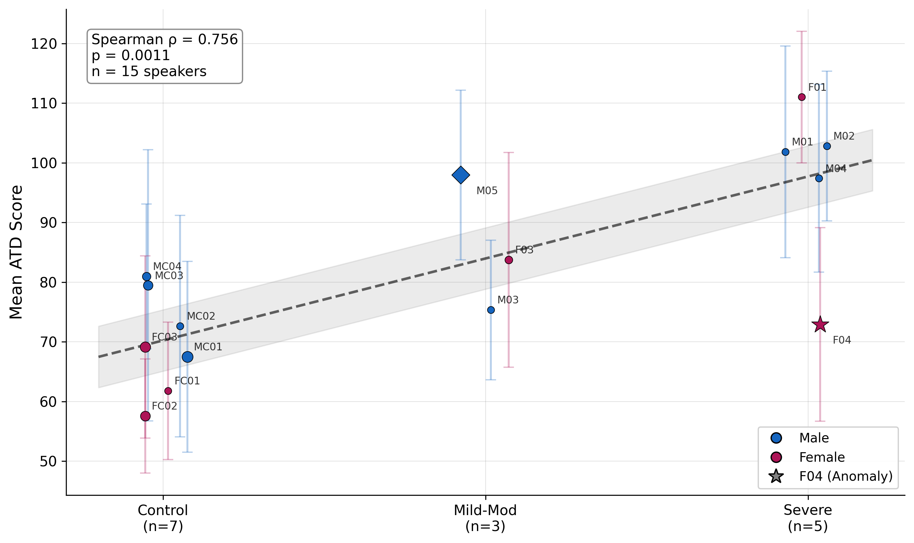

# Articulatory Trajectory Deviation (ATD)
### Dysarthric Speech Severity Estimation via Frozen SSL Latent Space Geometry (Within-Corpus Calibration)

<p align="center">
  
</p>

<p align="center">
  <b>Articulatory trajectories in WavLM latent space for the word "yes".</b><br>
  Control speakers (left) trace tight, consistent paths. Severe dysarthric speakers (right) deviate sharply.<br>
  ATD measures this deviation — no fine-tuning, no labels required.
</p>

---

<p align="center">
  
  
  
  
  
  
  
</p>

---

## What Is This?

Dysarthria is a motor speech disorder — caused by cerebral palsy, ALS, stroke, or traumatic brain injury — that affects millions of people worldwide. Assessing its severity currently requires a trained Speech-Language Pathologist: expensive, scarce, and subjective.

**We propose ATD (Articulatory Trajectory Deviation):** a frozen-SSL articulatory metric that estimates dysarthric severity directly from raw audio — with no labeled severity ratings and no fine-tuning of any model. The control reference trajectories are built *within* the target corpus, so the deployable mode is within-corpus calibration; genuine zero-shot cross-corpus transfer did not hold (see Limitations).

### The Core Insight

Large SSL models like WavLM-Large, pre-trained on 94,000 hours of neurotypical speech, have implicitly learned a geometric manifold of normal articulatory execution. Neurotypical speakers trace tight, consistent trajectories through this space when producing any given word. Dysarthric speakers — due to impaired motor control — trace erratic, deviated paths.

**ATD measures the geometric deviation of a speaker's WavLM trajectory from neurotypical reference trajectories. The geometry IS the severity signal.**

---

## Key Results

<!-- NOTE: fig5_results_comparison.png was rendered from the earlier, under-tuned
     baseline run (strawman MFCC 0.802 and the retracted ρ=−0.795 pooled-WavLM bar)
     and is intentionally NOT embedded here until regenerated from
     results/finetuned_ssl_baseline.json. The table below is the source of truth. -->

**ATD does not beat a fairly-tuned probe on accuracy — and we say so.** All trained heads below are tuned fairly: the regression head *and* its hyperparameters are refit inside each leave-one-speaker-out (LOSO) fold by nested group-CV. ATD is zero-shot (no training, no labels), so its LOSO score equals its full-set score. ρ is speaker-level Spearman vs severity (n = 15); RMSE is on the 0–1 severity scale (ATD's raw units are scale-mismatched, so its RMSE is via a per-fold Ridge map). Source: `results/finetuned_ssl_baseline.json`.

| Method | Training | Spearman ρ (n=15) | RMSE ↓ |
|---|---|---|---|
| MFCC + RBF-SVR | trained (LOSO) | 0.609 | 0.743 |
| WavLM-L9 pool + Ridge | trained (LOSO) | 0.760 | **0.581** |
| WavLM-L9 pool + LinearSVR | trained (LOSO) | **0.775** | 0.623 |
| **ATD (ours)** | **zero-shot** | 0.756 | 0.671 |

A fairly-tuned linear probe on mean-pooled WavLM **matches or slightly exceeds** ATD (Ridge 0.760 / LinearSVR 0.775 vs ATD 0.756) and beats it on RMSE (0.581 vs 0.671). **ATD's value is not superior accuracy** — it is that it reaches *comparable* accuracy **zero-shot** (no training data, no labels), plus per-phoneme interpretability and real-time operation. ATD does beat the classical tuned MFCC baseline (0.756 vs 0.609).

> **⚠ Retraction (integrity).** An earlier version of this table reported the pooled-WavLM Ridge probe with a *negative* Spearman ρ = −0.795 and described it as "a real result, not a sign error." **That was wrong.** It was an under-regularization artifact (Ridge α = 1). A fair hyperparameter search selects α = 1000 on every LOSO fold and yields ρ = **0.760**. The negative figure is retracted; the pooled-WavLM baseline is in fact a strong trained reference that ATD matches without training.

### Headline Numbers

- **Speaker-level Spearman ρ = 0.756** at WavLM **Layer 9** (p = 0.0011, n = 15 speakers; 95% bootstrap CI [0.40, 0.92]). **Robust to leakage:** unchanged (0.756 → 0.756) under leave-one-control-out references; the early Layer 1 alternative inflates (0.775 → 0.687). See `results/deleak_report_fast.json`.
- **Matches a trained frozen-WavLM probe, zero-shot.** A fairly-tuned mean-pooled WavLM-L9 probe (Ridge ρ = 0.760, LinearSVR ρ = 0.775, refit per LOSO fold) matches/slightly exceeds ATD (0.756) and beats it on RMSE (0.581 vs 0.671). ATD is **not** more accurate — its edge is label-free zero-shot operation. `results/finetuned_ssl_baseline.json`.
- **Beats the classical tuned MFCC baseline** (ρ = 0.756 vs 0.609). Mapped to the 0–1 severity scale via a per-fold Ridge, ATD's RMSE (0.671) is ~9.7% below the fairly-tuned MFCC (0.743). *(The old "16.3% vs MFCC" figure used an under-tuned MFCC and is superseded.)*
- **Dysarthric-subgroup Spearman ρ = 0.394** (the rank correlation over the 8 dysarthric speakers, **not** a leave-one-speaker-out CV score): **non-significant** (n = 8, p = 0.33, 95% CI [−0.29, 0.90]). Directional indicator only; pairwise rank concordance ≈ 73%.
- **Cohen's d = 1.488** (large effect) between control and severe groups — **utterance-level** (pseudo-replicated). The **speaker-level, de-leaked** effect size is **d = 2.63** (controls vs severe, Layer 9; `results/deleak_report_fast.json`).
- **ATD-duration correlation r = 0.105** (Spearman −0.07) — ATD is NOT a proxy for speaking rate.
- **No fine-tuning** — WavLM is permanently frozen.

---

## Layer Analysis

<p align="center">
  
</p>

We analyzed all 9 sampled WavLM-Large layers. Every single layer achieves statistically significant correlation (p < 0.01), and **all 9 are comparable within bootstrap noise** (Δρ < 0.09, overlapping 95% CIs).

**Layer 9 is the primary, leakage-robust layer.** A naive single-reference sweep marginally favours Layer 1 (ρ = 0.775 vs 0.756), but that edge does **not** survive leakage control: under leave-one-control-out (LOCO) references, Layer 1 deflates to ρ = 0.687 while **Layer 9 is unchanged at 0.756**. Early SSL layers encode speaker identity, so a control speaker's own utterances inside its reference deflate its ATD and inflate the Layer-1 correlation; mid-network Layer 9 encodes articulation and is leakage-robust. We therefore report Layer 9 as the headline layer. (Source: `results/deleak_report_fast.json`.)

---

## Speaker Profiles

<p align="center">
  
</p>

ATD reveals clinically meaningful speaker profiles beyond categorical labels:

- **F04** (labeled Severe): ATD = 72.9 — within control range, consistent with documented preserved intelligibility in her spastic dysarthria profile
- **M05** (labeled Mild-Moderate): ATD = 97.96 — approaching severe range, consistent with notably reduced intelligibility

**ATD captures articulatory execution quality independently of diagnostic categorization.**

---

## How ATD Works

```
Raw audio (16kHz)
      ↓
WavLM-Large (frozen, eval mode — never fine-tuned)
      ↓
Frame-level embeddings: shape (T_frames, 1024)
      ↓
PCA reduction: (T_frames, 1024) → (T_frames, 64)
      ↓
DTW alignment to control reference trajectory R_w
      ↓
ATD(u, w) = DTW_distance / max(T_utterance, T_reference)
      ↓
Speaker ATD = mean across all utterances
      ↓
Severity estimate (0=Control, 1=Mild, 2=Severe)
```

### Formal Definition

For utterance $u$ of word $w$ by speaker $s$, with WavLM layer $l$ embeddings:

$$\text{ATD}(u, w, l) = \frac{\text{DTW}\left(\text{PCA}_{64}(\mathbf{E}_u^{(l)}),\; \mathbf{R}_w^{(l)}\right)}{\max(T_u,\, T_{\mathbf{R}_w})}$$

Where:
- $\mathbf{E}_u^{(l)} \in \mathbb{R}^{T_u \times 1024}$ — frame-level WavLM embeddings
- $\mathbf{R}_w^{(l)}$ — reference trajectory built by DTW-averaging 7 control speakers
- $\text{PCA}_{64}$ — same PCA model used for both reference and test (same coordinate space)
- Length normalization ensures ATD measures quality, not speaking rate

---

## Dataset

**TORGO** — University of Toronto dysarthric speech database

| Group | Speakers | Utterances | Severity |
|---|---|---|---|
| Control | FC01, FC02, FC03, MC01, MC02, MC03, MC04 | ~5,220 | None |
| Mild-Moderate | F03, M03, M05 | ~1,425 | 1 |
| Severe | F01, F04, M01, M02, M04 | ~1,181 | 2 |
| **Total** | **15** | **~7,826** | — |

- Headset microphone recordings only (higher SNR)
- Resampled to 16kHz, normalized to -20 dBFS
- 794 words with control reference trajectories built
- 9 words shared by all 15 speakers

---

## Ablation Study

Every design decision is empirically justified:

ρ (dys-subgroup) below is the n = 8 dysarthric-subgroup Spearman (non-significant; directional only). Values match `results/tables/table2_ablations.csv`.

| Variant | Spearman ρ (Global) | ρ (dys-subgroup) | Interpretation |
|---|---|---|---|
| **Full ATD — Layer 9 (primary)** | 0.756 | 0.394 | Leakage-robust headline layer |
| Full ATD — Layer 1 | 0.775 | 0.394 | Inflated by leakage; LOCO ρ = 0.687 |
| No DTW (pool-then-L2) | 0.471 | 0.394 | DTW critical (−40%); same computation as mean-pool |
| No PCA — 1024-dim DTW | 0.802 | **−0.056** | Higher global ρ, but subgroup ρ collapses |
| MFCC trajectory DTW | 0.849 | 0.282 | High global ρ, lower subgroup ρ |

> **Note.** The "No DTW — Mean L2" and "Mean-pool distance" rows in earlier drafts were the *same* algebraic computation (pool the frames, take an L2 distance); they are collapsed into one row here.

**Key findings:**
- Removing DTW drops global ρ by 40% — temporal alignment carries most of the signal.
- The full-dimension (No-PCA) variant has a *higher* global ρ (0.802 > 0.756) but its dysarthric-subgroup ρ collapses to −0.056. **PCA-64 is therefore a speed/robustness trade-off, not a lossless step** — we attribute the global gap to n = 15 sampling noise, and the extra dimensions appear to encode speaker-specific rather than severity-relevant structure. (All subgroup numbers are n = 8, non-significant, directional only.)

---

## Installation

```bash
# Clone the repository
git clone https://github.com/YOURUSERNAME/dysarthria-atd.git
cd dysarthria-atd

# Create conda environment
conda create -n dysarthria python=3.11 -y
conda activate dysarthria

# Install PyTorch with CUDA
conda install pytorch==2.2.2 torchaudio==2.2.2 pytorch-cuda=12.1 -c pytorch -c nvidia -y

# Install remaining dependencies
pip install -r requirements.txt
```

**Requirements:** NVIDIA GPU with ≥ 8GB VRAM, CUDA 12.1+, ~80GB disk space for embeddings

---

## Dataset Setup

1. Download TORGO from: http://www.cs.toronto.edu/~complingweb/data/TORGO/torgo.html
2. Download all 4 archives: F.tar.bz2, FC.tar.bz2, M.tar.bz2, MC.tar.bz2
3. Extract to `data/raw/torgo/`:

```
data/raw/torgo/
├── F/   (F01, F03, F04)
├── FC/  (FC01, FC02, FC03)
├── M/   (M01, M02, M03, M04, M05)
└── MC/  (MC01, MC02, MC03, MC04)
```

---

## Quick Start (Verify Setup — 5 Minutes)

```bash
conda activate dysarthria
python experiments/01_verify_environment.py
```

Expected output:
```
[PASS] Python 3.11.x
[PASS] PyTorch 2.2.2
[PASS] CUDA available
[PASS] GPU: RTX 4080 (12GB)
[PASS] All 20 packages importable
[PASS] TORGO data detected
✅ ENVIRONMENT READY
```

---

## Reproduce All Results

```bash
conda activate dysarthria
python reproduce_all.py                  # full pipeline, skip steps whose outputs exist
python reproduce_all.py --force          # re-run every step
python reproduce_all.py --skip-extract   # reuse cached SSL embeddings
python reproduce_all.py --include-uaspeech  # also run UASpeech (UA_01..UA_05)
python reproduce_all.py --smoke          # dry-run plan, no execution
```

`reproduce_all.py` shells out to each `experiments/*.py` step in order, writes per-step logs to `results/logs/reproduce_all/`, and skips a step if its expected output artifact already exists on disk (override with `--force`). This runs the full pipeline end-to-end:

| Step | Script | Time |
|---|---|---|
| Audio preprocessing | 03_preprocess_audio.py | ~20 min |
| SSL extraction (WavLM-Large) | 04_extract_ssl.py | ~2 min (RTX 4080) |
| Reference building | 05_build_references.py | ~20 min |
| ATD computation | 06_compute_atd.py | ~30 min |
| ATD validation | 07_validate_atd.py | ~5 min |
| Baseline models | 08_baselines.py | ~50 min |
| Layer analysis | 09_layer_analysis.py | ~30 min |
| LOSO validation | 10_loso_validation.py | ~20 min |
| Ablation study | 11_ablations.py | ~30 min |
| Figure generation | 12_generate_figures.py | ~10 min |
| Table generation | 13_generate_tables.py | ~2 min |

**Total: ~4 hours end-to-end on RTX 4080**

---

## Project Structure

```
dysarthria-atd/
├── src/
│   ├── data_pipeline.py      # TORGO loading, preprocessing, splits
│   ├── ssl_extractor.py      # Frozen WavLM-Large extraction
│   ├── reference_builder.py  # Control reference trajectory construction
│   ├── atd_metric.py         # ATD computation + statistical validation
│   ├── baselines.py          # MFCC+SVR, WavLM pool+Ridge baselines
│   ├── analysis.py           # Confound analysis, session consistency
│   └── visualization.py      # All 6 publication figures
├── experiments/
│   ├── 01_verify_environment.py
│   ├── 02_explore_torgo.py
│   ├── 03_preprocess_audio.py
│   ├── 04_extract_ssl.py
│   ├── 05_build_references.py
│   ├── 06_compute_atd.py
│   ├── 07_validate_atd.py
│   ├── 08_baselines.py
│   ├── 09_layer_analysis.py
│   ├── 10_loso_validation.py
│   ├── 11_ablations.py
│   ├── 12_generate_figures.py
│   └── 13_generate_tables.py
├── results/
│   ├── figures/              # All 6 figures (PNG + PDF)
│   ├── tables/               # CSVs for all results
│   ├── paper_numbers.json    # Single source of truth for all paper numbers
│   ├── atd_scores.csv        # Utterance-level ATD scores
│   ├── speaker_atd.csv       # Speaker-level ATD aggregation
│   └── atd_validation_report.json
├── paper/
│   ├── sections/             # LaTeX sections
│   ├── figures/              # Publication figures
│   ├── tables/               # LaTeX tables
│   └── main.tex
├── data/
│   ├── processed/metadata/   # metadata_unified.csv
│   └── splits/               # splits.json (LOSO, severity, cross-session)
├── reproduce_all.py
├── requirements.txt
└── README.md
```

---

## Key Design Decisions

| Decision | Choice | Why |
|---|---|---|
| SSL model | WavLM-Large | Denoising objective — most robust to irregular speech |
| Model state | **Frozen always** | Preserves pre-trained articulatory geometry |
| Features | Frame-level | Trajectory structure, not mean-pooled averages |
| Alignment | DTW (fastdtw) | Handles 2–3× slower dysarthric speech naturally |
| Reduction | PCA → 64 dims | 16× DTW speedup (speed/robustness trade-off, not lossless) |
| References | Control speakers only | True neurotypical articulation, not mild dysarthric |
| Reference protocol | Leave-one-control-out (LOCO) | Removes speaker-identity leakage; Layer 9 robust, Layer 1 inflates |
| Headline correlation | All 15 speakers | Reported with dysarthric-subgroup (n = 8, NS) as a directional check |
| Random seed | 42 everywhere | Full reproducibility |

---

## Why This Matters

**For researchers:**
- A narrow, specific contribution: frame-level DTW *trajectory* geometry in a *frozen* SSL latent space, plus exact per-phoneme path attribution (with a silence/unattributed residual) and an exact-parity real-time streaming variant. This builds on — and does not displace — the healthy-reference subspace-distance line (Janbakhshi et al. 2019/2021) and recent training-free frozen-SSL subspace work; we do **not** claim a paradigm first.
- All 9 WavLM layers are comparable within bootstrap noise; Layer 9 is robust under leave-one-control-out references while Layer 1 is inflated by speaker-identity leakage.
- An honest negative: the pre-registered articulatory-specificity perturbation test was *falsified* (additive noise perturbs ATD more than formant shift). Pathology-vs-accent specificity is instead supported by a separate 4-corpus analysis.

**For clinicians:**
- No labeled severity ratings needed — references are built from a corpus's own control speakers (within-corpus calibration)
- Interpretable — trajectory deviation has geometric meaning
- Deployable — no retraining, no clinical infrastructure
- Speaker-specific profiles reveal execution quality beyond categorical labels

**For the field:**
- Framework *prospectively* extensible to: ALS progression tracking, therapy monitoring, cross-language dysarthria, other motor speech disorders. Cross-corpus generalization is **not yet demonstrated** — see Limitations.

---

## Limitations

- **Cross-corpus result on UASpeech is null.** Direct application of TORGO-built reference trajectories to UASpeech yields ρ = −0.22 (p = 0.43, n = 15 dysarthric); pooled-corpus ρ = −0.07. We hypothesize that UASpeech's isolated-word stimuli (mean ≈ 127 frames) sit below the trajectory-length regime where DTW signal stabilizes (TORGO mean ≈ 155 frames). Cross-corpus extension is left to future work.
- **Sample size.** n = 15 TORGO speakers. Bootstrap CIs are wide; the dysarthric-subgroup Spearman (n = 8) is non-significant at α = 0.05 (p = 0.33) and is reported as a directional indicator, not a leave-one-speaker-out CV result.
- **Single dataset for headline numbers.** Generalization to PD, ALS, post-stroke speech, and non-English dysarthria is open.
- **F04 leverage.** Removing F04 alone shifts ρ from 0.756 → 0.855. Influence diagnostics across all speakers will be added in v2.
- **Non-deterministic FP16 inference.** WavLM-Large embeddings are extracted in FP16; bit-exact reproduction across GPU drivers is not guaranteed. For paper-grade reproduction we ship the embeddings on Zenodo (forthcoming) rather than asking reviewers to re-extract.

---

## Figures

| Figure | Description |
|---|---|
| Fig 1 | Layer-wise Spearman ρ across 9 WavLM layers |
| Fig 2 | UMAP trajectory visualization: Control vs Mild vs Severe |
| Fig 3 | Speaker-level ATD vs severity scatter with regression |
| Fig 4 | ATD distribution violins with significance brackets |
| Fig 5 | Results comparison: RMSE and dysarthric-subgroup Spearman bar charts |
| Fig 6 | Per-speaker per-word ATD heatmap |

---

## Citation

```bibtex
@inproceedings{atd2026interspeech,
  title     = {Articulatory Trajectory Deviation: Dysarthric Speech 
               Severity Estimation via Frozen {SSL} Latent Space Geometry
               with Within-Corpus Calibration},
  author    = {Anonymous},
  booktitle = {Proc. INTERSPEECH 2026},
  year      = {2026},
  note      = {Under review}
}
```

*BibTeX will be updated upon acceptance.*

---


<p align="center">
  <i>A narrow, honestly-scoped frozen-SSL trajectory metric — every number traces to a file in <code>results/</code>.</i><br>
  <i>Spearman ρ = 0.756 (WavLM Layer 9, robust under leave-one-control-out) · p = 0.0011 · no fine-tuning.</i>
</p>